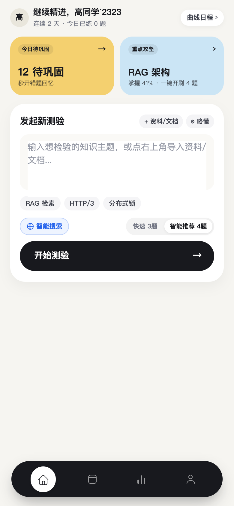
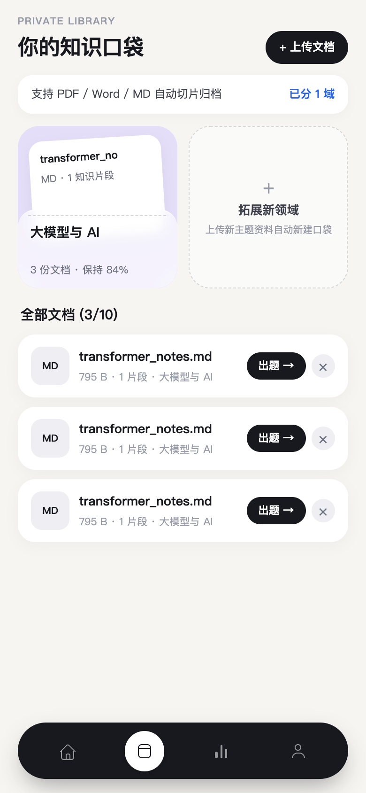
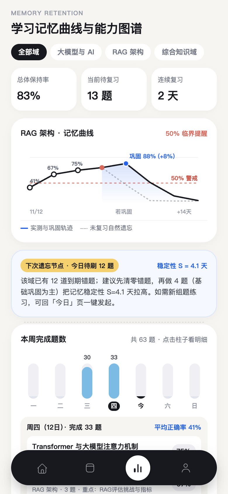
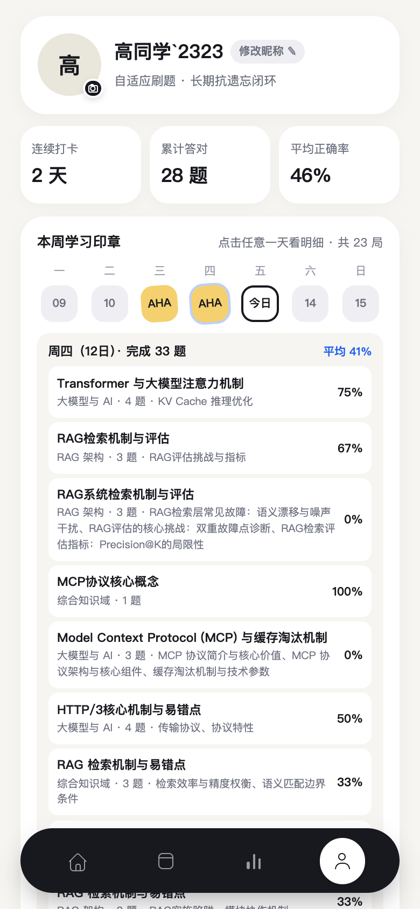
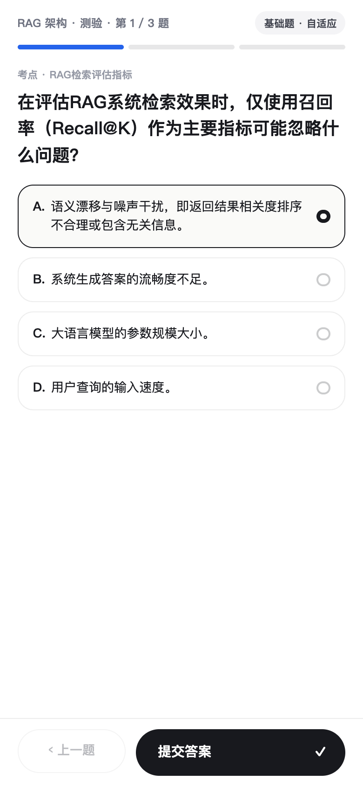
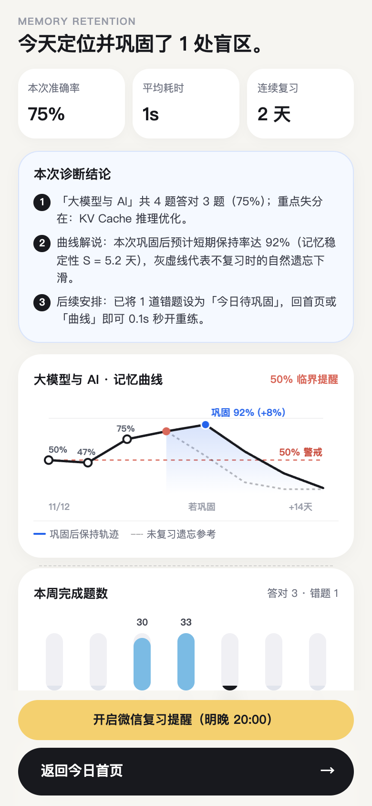
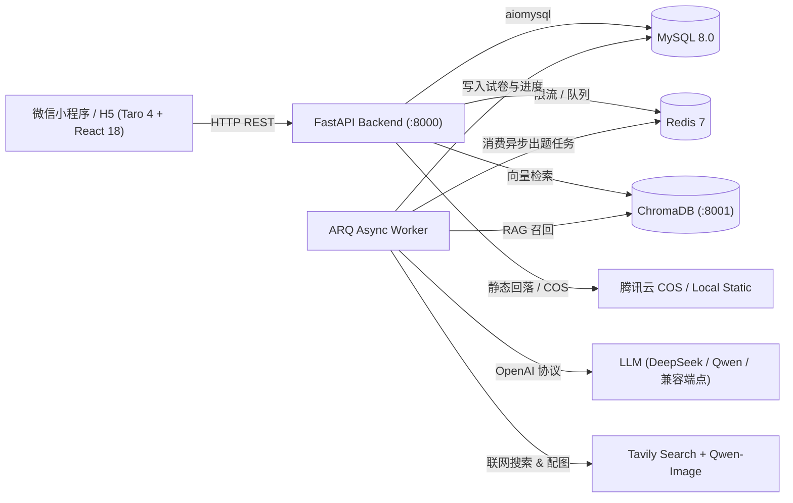

<div align="center">

# 知行快刷 · ZhiXing Quiz

**AI 知识库自测与 SM-2 抗遗忘闯关双端平台（微信小程序 · H5）**

*个人资料 RAG 检索 · Tavily 实时联网出题 · ARQ 异步后台组卷 · SM-2 记忆留存曲线 · 多模型热切换*

[](./backend/pyproject.toml)
[](./backend/app/main.py)
[](./frontend/package.json)
[](./backend/app/services/vector_store_service.py)
[](./backend/app/workers/arq_worker.py)
[](./docker-compose.yml)

<br />

</div>

---

## 为什么选择知行快刷？

传统刷题工具往往只有静态题库，而普通 AI 对话框缺少「出题 → 计时作答 → 错题沉淀 → 定期抗遗忘复盘」的完整学习闭环。**知行快刷（ZhiXing Quiz）** 将 **暖石膏极简移动交互**、**个人知识库 RAG + 实时联网检索** 与 **SM-2 间隔重复算法** 深度融合，打造出一套可私有化部署的双端学习系统：

- **三源融合精准出题**：支持自由输入主题、导入个人知识库文档（PDF / Markdown / TXT / Word）进行 Chroma 向量检索，并可一键开启 Tavily 实时联网搜索，拒绝脱离资料的泛泛提问。
- **无痛异步后台组卷**：依托 Redis 7 + ARQ Worker 队列异步编排题目与配图；出题期间可自由浏览其他页面或先刷到期错题，底部悬浮胶囊实时同步进度，就绪后一键直达答题页。
- **真正闭环的 SM-2 抗遗忘**：交卷后错题自动入队，支持「秒开原题回顾」与「AI 举一反三变式重练」，连续巩固 3 轮即可自动毕业出列，同时通过 7 日记忆曲线追踪知识域掌握度。
- **零绑定多模型兼容**：基于 `LLM_*` 标准 OpenAI 兼容协议封装，支持随时热切换 DeepSeek-V3/R1、通义千问 Qwen、智谱 GLM、硅基流动或 OpenAI 网关，内置 `<think>` 推理块剥离与 `response_format` 降级保护。

---

## 产品界面一览

<table>
  <tr>
    <td width="33.3%" valign="top" align="center">
      
      <p><b>首页工作台</b><br /><sub>冷启动引导、今日待巩固 / 重点攻坚双砖块、出题输入与资料/难度快捷配置。</sub></p>
    </td>
    <td width="33.3%" valign="top" align="center">
      
      <p><b>知识口袋（RAG 资料库）</b><br /><sub>上传私有文档自动切片向量化，按领域筛选资料并支持一键组卷。</sub></p>
    </td>
    <td width="33.3%" valign="top" align="center">
      
      <p><b>记忆曲线与掌握度</b><br /><sub>可视化 7 日抗遗忘留存曲线、薄弱知识域分布与每日复习调度。</sub></p>
    </td>
  </tr>
  <tr>
    <td width="33.3%" valign="top" align="center">
      
      <p><b>学习档案与错题巩固本</b><br /><sub>本周学习印章下钻、错题手风琴展开、AI 变式重练及历史练习折叠/续答。</sub></p>
    </td>
    <td width="33.3%" valign="top" align="center">
      
      <p><b>沉浸答题与避坑解析</b><br /><sub>轻量化对错反馈横幅、暖红避坑解析卡与历史未交卷记录断点续答。</sub></p>
    </td>
    <td width="33.3%" valign="top" align="center">
      
      <p><b>智能诊断结算报告</b><br /><sub>客观得分统计、错题自动纳入 SM-2 队列提示与 AI 薄弱点复盘建议。</sub></p>
    </td>
  </tr>
</table>

---

## 核心能力

### 1. 知识库 RAG + 实时联网双引擎出题
- **多格式文档解析与向量化**：支持上传 PDF、Markdown、TXT 等资料，自动分块并写入独立 ChromaDB 服务，出题时按知识域精准召回 Top-K 上下文片段。
- **自评难度自适应**：结合用户自评档位（略懂 / 熟练 / 精通 / 挑战）与历史答题表现动态调整题型（单选 / 多选）、题量与干扰项深度，并可选配 AI 概念示意图（DashScope `qwen-image-2.0` + COS/本地静态存储）。

### 2. SM-2 间隔重复与错题毕业闭环
- **自动入队与轮次追踪**：每次交卷的错题自动进入待巩固队列，记录掌握轮次（第 1/3 ~ 3/3 轮）与下次到期时间。
- **双轨重练模式**：支持 0.1s 秒开原题直接重做，或一键调度 AI 基于原考点生成「举一反三」变式新题，彻底避免背答案假象。

### 3. 双端极简交互与异步体验
- **Taro 4 同构双端**：一套 React + TypeScript 代码同步编译微信小程序（含原生 `custom-tab-bar` 矢量胶囊导航）与 H5 端（`FloatingDock`）。
- **跨页后台任务管理**：`backgroundQuizManager` + `BackgroundTaskPill` 在组卷期间跨 Tab 实时推送阶段进度，支持断点续答与只读回顾。

### 4. 模型热切换与生产安全基线

| 配置维度 | 默认支持 | 切换 / 扩展能力 |
| :--- | :--- | :--- |
| **对话大模型** | `DeepSeek` (`deepseek-chat`) | 通过 `LLM_API_KEY` / `LLM_BASE_URL` / `LLM_MODEL` 热切换任意 OpenAI 兼容端点（Qwen / GLM / R1 等） |
| **推理模型兼容** | 自动识别 | 自动剥离 `<think>` 块，针对 `-r1` / `reasoner` / `qwq` 自动关闭 `json_object` 避免 400 报错 |
| **向量模型** | DashScope `text-embedding-v4` | 支持通过 `EMBEDDING_*` 独立切换至硅基流动 `BAAI/bge-m3` 等兼容向量服务 |
| **生产安全护栏** | `APP_ENV=production` 强校验 | 强制禁用 `dev-login`、校验 32+ 位 `JWT_SECRET`、Redis 限流与微信 `code2session` 登录 |

---

## 系统架构



---

## 快速开始

### 方式一：Docker Compose 一键全栈启动（推荐）

```bash
# 1. 复制并配置环境变量（填入你的大模型 API Key 等）
cp backend/.env.example backend/.env

# 2. 启动 MySQL、Redis、Chroma、FastAPI 与 ARQ Worker 全套服务
docker compose up -d --build
```

### 方式二：本地源码开发调试（`uv` + `pnpm`）

```bash
# 1. 启动基础中间件（MySQL + Redis）
docker compose up -d mysql redis

# 2. 启动 Chroma 向量服务、ARQ Worker 与 FastAPI
cd backend
cp .env.example .env
uv sync
uv run chroma run --host 127.0.0.1 --port 8001 --path ./data/chroma
uv run arq app.workers.arq_worker.WorkerSettings
uv run uvicorn app.main:app --reload --host 0.0.0.0 --port 8000

# 3. 运行后端质量检查与单元测试（193 passed）
uv run ruff check app tests
uv run pytest -q

# 4. 启动前端 H5 或微信小程序编译
cd ../frontend
pnpm install
pnpm typecheck
pnpm dev:h5             # 浏览器调试 H5（http://127.0.0.1:10086）
pnpm build:weapp:local  # 编译本地微信小程序包至 frontend/dist/
# 生产发布构建：TARO_APP_API_BASE_URL=https://your-api.example.com pnpm build:weapp
```

---

## 项目文档与交接索引

- **[项目交接与生产检查清单（HANDOFF.md）](./docs/HANDOFF.md)** — 后续接手开发必读：完整代码索引、换模型指南、生产上线风险清单
- **[开发规范总入口（AGENTS.md）](./AGENTS.md)** — 工程边界与编码约定
- **[系统架构与接口契约](./docs/ARCHITECTURE.md)** · **[详细架构设计](./docs/02-design/system-architecture.md)** · **[产品需求文档](./docs/PRODUCT.md)**
