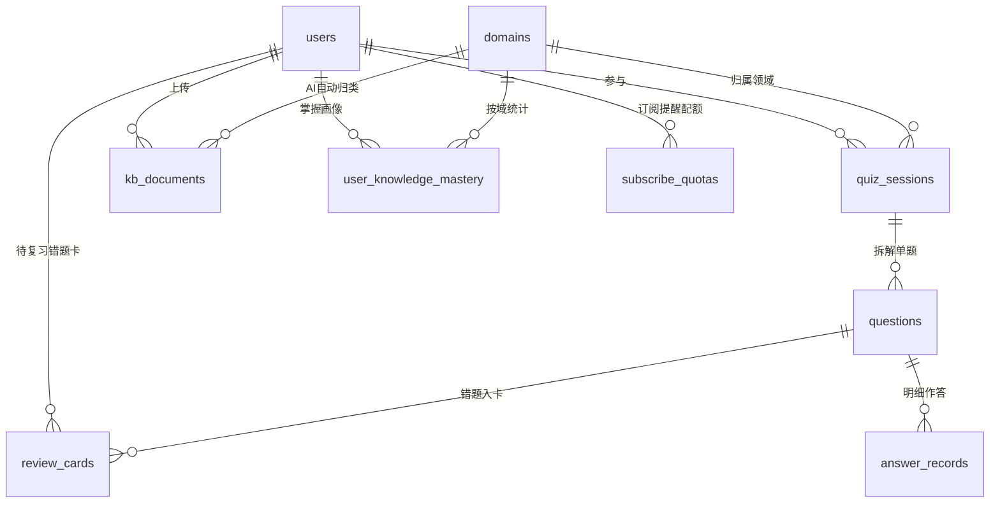

# 知行快刷 V2.0｜立项重塑、高并发架构演进与技术选型白皮书

> 状态：V2 规划与原型审阅阶段（仅设计文档与规划产物，**尚未改动 V1 线上代码**）。  
> 配套视觉产物：[V2 架构与 ER 规划图](prototypes/v2-architecture-diagram.html)、[V2 高保真 6 屏交互原型](prototypes/zhixing-quiz-v2-prototype.html)、[OpenSpec 变更规划](../../openspec/changes/v2-adaptive-platform-upgrade/proposal.md)。

---

## 1. 为什么必须重构立项（V1 的结构性短板复盘）

V1 跑通了「输入主题 / 上传文档 → 异步出题 → 答题 → 报告 → 历史回看」最小闭环，但在**产品留存闭环**与**大平台工程评估维度**上存在 4 个根本短板：

1. **只有「单次刷题工具感」，没有「抗遗忘长期学习闭环」**：所有题目挤在 `quiz_sessions.questions_json` 一坨 JSON 中，数据库无法以**单题/知识点/难度**为单位追踪错题生命周期，既做不出过段时间的到期错题回顾，也做不出直观的记忆曲线可视化。
2. **「经验值 XP」与「固定 5 题」脱离教学目标**：`10 + 答对数 × 2` 的全局累加数字既不区分知识领域（计算机网络 vs 英语词汇 vs 历史），也不随时间遗忘衰减；不管用户是零基础小白还是领域高手，全部死板默认出 5 道混杂难度题。
3. **单进程架构瓶颈（V1 `--workers 1`）**：异步任务依赖进程内 `asyncio.Task`（重启即丢）、限流靠本地内存字典（多 Worker 失效）、Chroma 用本地 SQLite/HNSW 嵌入式直连（并发写入需要进程内锁，多进程必锁库）。
4. **LangGraph ReAct 黑盒决策慢且不可控**：每次出题都要跑 `create_react_agent` 多轮“思考 → 选工具 → 总结”，再交给 `quiz_chain` 二次生成，平均耗时 `18~44s`，且在未配置 Tavily Key 时静默直出，缺少显式路由、可控开关与来源透明标注。

**V2 立项重塑定位**：  
> **基于知识域画像自适应出题 + 间隔重复（SM-2）驱动的分布式异步 AI 评测平台**。  
> 不只是单字词卡，而是支持 **多格式资料（PDF/Word/MD/TXT）与自由主题自动归类**、**后端依据掌握画像动态调控题量与难度**、**Redis + ARQ 削峰与延迟召回** 的完整工程实践样本。

---

## 2. 核心技术选型对比与权衡（项目评估问答直通）

### 2.1 为什么加 Redis 和 ARQ 队列？影响在哪里？

| 维度 | V1 方案（单 Worker + 进程内 `asyncio.Task`） | V2 方案（FastAPI 多 Worker + Redis + ARQ） | 对系统的真实影响与代价 |
| :--- | :--- | :--- | :--- |
| **进程扩展性** | 强绑定 `--workers 1`，单核 CPU 吃满无法扩容 | API 可开 `--workers N` 水平扩容；Worker 池独立伸缩 | ✅ 解除单进程并发天花板；⚠️ 需同步拆分嵌入式 Chroma 为独立 Server |
| **任务可靠性** | API 重启/崩溃时内存中 `asyncio.Task` 直接丢失 | 任务持久化在 Redis，Worker 支持超时控制、自动重试（指数退避）与死信兜底 | ✅ 出题/生图/RAG入库重启不丢；⚠️ 必须严格保证入库写入幂等 |
| **延迟错题提醒** | 无原生延迟机制，只能粗粒度扫表或被动加载 | **ARQ 原生 `defer_by` 延迟队列** 精确投递到期复习任务 + **Cron 扫表补偿兜底** | ✅ 对标大厂延迟消息+补偿范式；⚠️ 若 Redis 持久卷丢失需靠 Cron 自愈重构延迟队列 |
| **高频热点读写** | 限流与用户画像每次查 MySQL 或本地内存 | Redis 承载滑动窗口分布式限流 + 用户知识域画像读缓存（交卷后异步失效/刷新） | ✅ 出题前 `O(1)` 读画像定难度与题量；⚠️ 引入运维复杂度（多容器部署与监控） |

**为什么选 ARQ 而不是 Celery / RabbitMQ / Kafka？**
- **vs Celery**：Celery 基于同步阻塞模型演化而来，与 FastAPI / `aiomysql` / LangChain 全异步 `async/await` 生态混用极易引发事件循环冲突；**ARQ 原生基于 `asyncio` + `redis.asyncio`**，复用同一套异步 Repo，轻量无沉重依赖。
- **vs Kafka / RabbitMQ**：本项目日吞吐在百到万级 AI 任务之间，引入 Kafka（需 ZooKeeper/KRaft + 分区协调）或 RabbitMQ（多维护一套 Erlang Broker）在个人/中小团队云主机（如 2C4G Docker Compose）属于**过度设计（Over-engineering）**；用 Redis + ARQ 即可一套中间件同时解决「异步任务队列 + 延迟队列 + 分布式限流 + 画像缓存」四件事，如果未来流量突破单 Redis 内存再无缝迁往 RabbitMQ/Kafka。

### 2.2 前端 React vs 后端 ReAct：为什么要去掉 LangGraph ReAct 循环？

先澄清两个完全不同的概念：
- **前端 `React`（Taro 4 + React 18）保留且非常好用**：负责微信小程序 + H5 双端组件化渲染，不做任何替换。
- **要重构去掉的是后端 LangChain/LangGraph 里的 `ReAct` Agent 多轮工具推理循环（`create_react_agent`）**：

| 对比维度 | 旧方案：LangGraph `ReAct` 循环 | V2 方案：LCEL 意图路由（`RunnableBranch`）+ 独立搜索开关 |
| :--- | :--- | :--- |
| **运行耗时** | 高：`LLM 思考(3s) → 工具调用(2s) → LLM 再总结(10s) → 出题 LLM(15s)`，实测常达 `18~44s` | 低：跳过多余中间总结，平均可压至 **`5~12s`** |
| **何时联网检索** | 交给大模型临场“猜”，且当前 `.env` 未配 Tavily 时会走空逻辑仍假装经过 Agent | **显式可控**：1) 用户端提供独立「联网增强」开关；2) 后端前置规则/轻量分类识别 URL 或高时效词才触发 Tavily；否则直走 **知识库向量直查** 或 **DeepSeek 参数直出** |
| **来源可观测性** | 混成一段摘要文本，用户不知题目依据从哪来 | 输出精确元数据 `source_type`（`kb_rag` / `web_search` / `llm_direct`），并在报告页透明展示 |
| **流式输出取舍** | V1 已实现阶段进度轮询（非 Token SSE） | **V2 保持「Redis 阶段缓存 + 2s 轮询」**：优先保障微信小程序各基础库版本零兼容事故（避免 `enableChunked` 分片解析与断连坑），把省出的后端算力优先投入到**去掉 ReAct 提速**上 |

---

## 3. V2 数据库演进设计（从 7 表扩展到 12 表体系）

在完全保留 V1 已有 7 张核心表向后兼容的基础上，新增 **5 张面向自适应评测、领域归类与间隔重复的领域表**：



### 3.1 新增与增强核心表结构

1. **`domains`（AI 自动归类的知识领域字典表）**：
   - `id`、`user_id`（0 表示通用标准领域，>0 为用户自定义/AI 动态归类聚合域）、`name`（如 `分布式缓存与Redis`、`计算机网络`、`LLM/RAG原理`、`英语核心词汇`）、`slug`、`color_hex`、`created_at`。
   - **AI 自动归类策略**：上传文档完成切片后或出题完成时，由异步任务调用低成本/结构化分类逻辑，将内容归纳进用户已有 `domains` 中最匹配的一类（相似度/语义归并防碎片化），若无匹配才新建领域，避免出现 100 个一次性杂乱标签。
2. **`questions`（单题规范化表，打破 `questions_json` 黑盒）**：
   - `id`、`question_uid`、`quiz_id`、`domain_id`、`knowledge_point`、`difficulty`（`easy` / `medium` / `hard`）、`type`、`stem`、`options_json`、`answer_json`、`explanation`、`image_url`、`source_doc_id`、`created_at`。
   - 原 `quiz_sessions.questions_json` 保留冗余快照以兼容历史只读查询，新增题目双写落库。
3. **`user_knowledge_mastery`（用户 × 知识域 × 难度三维掌握画像表）**：
   - `id`、`user_id`、`domain_id`、`self_rated_level`（冷启动自评：`unknown` 陌生 / `basic` 略懂 / `familiar` 熟练）、`mastery_score`（0~100 综合掌握度）、`retrievability`（当前记忆保持率 `0.0~1.0`，随时间衰减）、`easy_attempts`/`easy_correct`、`medium_attempts`/`medium_correct`、`hard_attempts`/`hard_correct`、`avg_duration_ms`、`last_practiced_at`、`updated_at`。
   - **唯一索引**：`UNIQUE KEY uk_user_domain (user_id, domain_id)`。
4. **`review_cards`（间隔重复错题复习卡表，参考 SM-2 算法）**：
   - `id`、`user_id`、`question_id`、`domain_id`、`repetition`（连续答对次数）、`interval_days`（当前间隔天数：1 → 3 → 7 → 15 → 30）、`ease_factor`（难度系数，默认 `2.5`）、`next_review_at`（**核心调度索引**）、`status`（`active` 复习中 / `mastered` 连续 3 次答对自动毕业 / `suspended` 搁置）、`trigger_source`（`auto_wrong` 答错自动收录 / `manual_mark` 蒙对主动标记）、`reminder_sent_at`、`updated_at`。
5. **`subscribe_quotas`（微信小程序订阅消息配额与偏好表）**：
   - `user_id`（PK）、`template_id`、`remaining_count`（一次性订阅可用余量）、`preferred_hour`（每日偏好提醒整点，默认 `20` 点）、`last_sent_at`、`updated_at`。

### 3.2 已有表补充字段（仍保持 `INFORMATION_SCHEMA` 幂等迁移）
- `users` 新增：`streak_days`（连续打卡天数）、`last_active_date`（最近活跃日期），弱化原单调 `total_xp`。
- `kb_documents` 新增：`domain_id`（AI 识别所属领域）、`auto_tags_json`。
- `quiz_sessions` 新增：`domain_id`、`source_type`（`kb_rag` / `web_search` / `llm_direct`）、`strategy_badge`（如 `摸底偏基础 · 5题`）。

---

## 4. 后端自适应出题与记忆衰减核心规则

### 4.1 后端如何“看数据决定输出少而简单还是多而深入”？（倒 U 型智能调控）

```text
请求到达 POST /api/v1/quiz/generate/async
  ├─ 1. 读 Redis 画像缓存（未命中查 MySQL user_knowledge_mastery）
  ├─ 2. 判断冷启动还是有历史数据（兼顾不打击新手、也不题海烦高手）：
  │     ├─ [冷启动/未测过该域]：
  │     │     • 用户选「陌生」或未知 → 少题入门：3~4 题，easy 70% / medium 30% / hard 0%
  │     │     • 用户选「略懂」        → 适中摸底：5 题，easy 40% / medium 50% / hard 10%
  │     │     • 用户选「熟练」        → 直接验证：4~5 题，easy 10% / medium 40% / hard 50%
  │     └─ [已有历史数据 · 倒 U 型曲线]：
  │           • mastery < 45%（薄弱期） → 推荐 4 题，easy 55% / medium 35% / hard 10%，聚焦高频错题知识点稳信心
  │           • 45% <= mastery < 80%（成长期）→ 推荐 6~8 题，easy 20% / medium 55% / hard 25% 重点突破
  │           • mastery >= 80%（快刷通）→ 收紧至 3 题精简抽查（easy 0% / medium 20% / hard 80% 变式防遗忘）
  └─ 3. 若用户显式选择「手动覆盖题量（3/5/10/15）」，以用户显式题量为准，难度配比仍由画像驱动
```

### 4.2 记忆持久度衰减与「到期复习 + ARQ 延迟双触达」

- **遗忘保持率公式**（前端绘图 & 后端排序共用）：  
  $$R(t) = e^{-\frac{t}{S}}$$
  其中 $t$ 为距离上次练习天数，$S$ 由 `user_knowledge_mastery` 下所有卡片的平均间隔稳定性估算。交卷答对后 $S$ 延长，$R$ 回升；长期不复习则 $R$ 滑向临界线 `50%`，在前端学习记忆曲线上标红预警。
- **ARQ 延迟队列 + 补偿流程（Context7 核验 `arq` API 规范）**：
  1. 交卷结算发现错题（或用户标记“蒙对再练”）→ 写入 `review_cards`（`next_review_at = now + interval_days`）→ 向 ARQ 投递 `activate_review_reminder` 延迟任务（`enqueue_job(..., _defer_by=timedelta(days=interval_days), _job_id=f"rev:{user_id}:{card_id}:{round}")`，注意长延迟需显式合理配置 `_expires` 避免过期早清），到期后消费 `subscribe_quotas` 发微信订阅消息。
  2. **兜底防丢机制**：ARQ Cron 每小时执行一次 `sweep_due_reviews`，扫描 `next_review_at <= NOW() AND status='active'` 且尚未通知的记录做幂等补偿提醒，彻底解决 Redis 重启或长延迟任务丢失隐患。

---

## 5. V2 美学定稿：方案 B（`MOVEPOP` 暖石膏极简高净度系统，无会员体系）

经多轮原型对比审阅，正式锁定 **方案 B（`MOVEPOP` 暖石膏 `#F6F5F1` × 奶油黄 `#F4D06F` × 雾天蓝 `#CBE5F5` × 黑曜石悬浮胶囊 Dock）**，完整排版与组件 Token 详见 [`v2-ui-design-system.md`](v2-ui-design-system.md) 与 [`prototypes/v2-editorial-3palettes.html`](prototypes/v2-editorial-3palettes.html)：

1. **视觉基调（高净度留白 · 克制双色 · 悬浮胶囊）**：
   - 以暖石膏 `#F6F5F1` + 纯白 `#FFFFFF` 构建 42%+ 呼吸留白；单屏至多使用 `2` 块低饱和主色（奶油黄 `04 错题` + 雾天蓝 `当前主攻域`），配合黑曜石 `#18191E` 主按钮与底部 **悬浮黑色胶囊 Dock**。
   - 不做会员制 / 付费订阅体系，全部核心能力面向学习者直接开放。
2. **微缩几何图标 & 内页延展标准**：
   - 废除拙劣的前端几何球动物拼装与多动物堆砌柱图，统一采用 **软圆角层叠几何微缩图标（SVG/静态精绘）** 与高对比数据图表。
   - 知识库采用 **`DAYPATCH` 半透明磨砂文件口袋**（斜插摘要卡片 + 领域自动归档）；图谱与复盘采用 **`学习记忆曲线` SVG（含 50% 临界预警线） + 本周 7 日细柱节律条**。
3. **首页输入与交互控制**：
   - 输入舱底部独立成行放置 **DeepSeek 同款圆角胶囊开关**（`🌐 智能搜索`、`🎨 配图`），下一行放置题量/熟悉度分段控制条（`3题 / 自适应 / 10题` 与冷启动 `陌生 / 略懂 / 熟练`），杜绝窄屏折行挤压；
   - 答题页底部采用 `112px + 1fr` 双栏底座，「`‹ 上一题`」提供**已提交题只读回看解析**，不可改选刷分。
4. **微信小程序动效工程规范（Context7 核验 Taro 4）**：
   - 轻量状态动画与页面反馈采用 CSS 弹簧微交互（`120ms` 轻缩按压、去廉价炫光）、`wx.vibrateShort` 微震动反馈与关键节点缓冲（`1.4s` 可跳过冷启动、`220ms` 提交后展解析缓冲、`450ms` 曲线绘制）；若后续补充独立 Lottie 动画资产，按 Taro `<Canvas type="2d">` (`createSelectorQuery().node()`) 托管于 CDN/COS。
