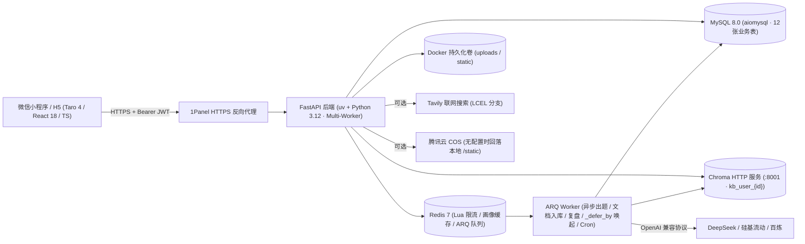

# ARCHITECTURE.md：技术与安全约束

> 状态：V2.0 已按「自适应学习 + 知识掌握图谱 + SM-2 间隔重复」全栈升级定稿；前端已完成 `MOVEPOP` 方案 B（4 Tab 黑曜石悬浮胶囊 Dock + `<Canvas type="2d">` 记忆曲线）重构并通过 H5 与微信小程序双端编译；后端已完成 MySQL 12 表迁移回填、Redis 7 + ARQ Worker、Chroma HTTP 与 LCEL `RunnableBranch` 多 Worker 改造。详细架构选型见 [`docs/02-design/v2-architecture-and-rationale.md`](02-design/v2-architecture-and-rationale.md)，表字段与 API 契约见 [`docs/02-design/system-architecture.md`](02-design/system-architecture.md)。

## 整体部署形态

自有云服务器通过 **Docker Compose** 运行 **FastAPI 后端（Multi-Worker 异步）**、**ARQ Worker**、**Redis 7**、**Chroma HTTP 向量服务** 与 **MySQL 8.0**，外层通过 **1Panel（Nginx / Caddy）** 提供公网 **HTTPS** 域名反向代理给微信小程序与 H5 调用。



## 锁定技术栈

- **前端**：Taro 4 (`4.1.x`) + React 18 + TypeScript + Sass，统一使用 **`pnpm`** 管理依赖（禁止混用 `npm`）；采用 `MOVEPOP` 暖石膏视觉规范（`#F6F5F1` / `#F4D06F` / `#CBE5F5` / `#18191E`）、4 Tab 黑曜石悬浮胶囊 Dock（`今日` / `口袋` / `曲线` / `我的`）与跨端 `<Canvas type="2d">` 遗忘曲线组件。H5 编译输出至 `frontend/dist-h5/`（`hash` 路由），微信小程序编译输出至 `frontend/dist/`。
- **后端**：Python 3.12 + **`uv`（`pyproject.toml` + `uv.lock`）** + FastAPI + Pydantic v2 + Uvicorn（支持 `--workers >= 1`）+ `arq` + `structlog`。
- **AI 编排与检索**：LangChain **LCEL `RunnableBranch`**（URL 提取 / 时效或显式联网 / 直出，取代慢速 ReAct 循环）+ `langchain-openai`（`check_embedding_ctx_length=False`）+ `langchain-chroma`（`chromadb.HttpClient`）+ `langchain-tavily`。
- **数据与队列存储**：MySQL 8.0（`aiomysql` 异步连接池 + `GET_LOCK` 并发安全的 12 表 DDL / 存量回填）+ Redis 7（Lua 原子滑动窗口限流、60s 画像缓存、ARQ 持久化任务队列与 `_defer_by` 延迟复习任务）+ Chroma HTTP 独立服务 + 腾讯云 COS（含自有静态目录回落）。
- **测试**：`pytest` + `pytest-asyncio` + `httpx` + Playwright 无头浏览器 E2E 闭环验证。

## 代码组织约束（单向依赖防改乱）

```text
backend/app/
  api/v1/routes/   路由层：仅做参数接收、JWT/Redis限流校验、调用 Service、返回 ApiResponse
  services/        业务层：自适应引擎、SM-2复习、LCEL检索、领域归类、报告与知识库编排
  workers/         Worker层：ARQ 异步任务函数与每小时 Cron 兜底扫表
  llm/ + prompts/  AI 层：大模型工厂、JSON 提取容错、V2 Prompt 模板
  repositories/    数据层：仅放 aiomysql SQL 读写与 FOR UPDATE 事务，禁止业务逻辑
  models/          数据契约：Pydantic v2 请求/响应与三维掌握画像 Schema
  core/            基础设施：config（生产安全门禁）、db（12 表 DDL/回填）、redis_client、auth、rate_limit（Lua）
```

## 数据模型与核心流程保障

- **MySQL 8.0（12 张表）**：在 V1 7 张表（`users`、`quiz_sessions`、`answer_records`、`reports`、`quiz_tasks`、`kb_documents`、`image_generation_logs`）基础上，新增 V2 5 张表：`domains`、`questions`、`user_knowledge_mastery`、`review_cards`、`subscribe_quotas`。
- **并发安全的 DDL 迁移与回填**：`init_mysql()` 使用 MySQL `GET_LOCK('zhixing_quiz_schema_init', 30)` 串行化建表、`INFORMATION_SCHEMA.COLUMNS` 17 项幂等列迁移与 `backfill_v1_data()` 存量数据回填；`recover_stale_jobs()` 在启用 ARQ 时不误杀队列中待消费任务。
- **异步出题与倒 U 自适应推荐**：`/quiz/generate/async` 经 ARQ 入队后推送阶段状态；`adaptive_service` 依据三维 E/M/H 掌握度或冷启动自评决定倒 U 推荐题量（`3~15` 题），`search_service` / `rag_service` 使用 LCEL 确定性路由，结果持久化并同步写入规范化 `questions` 表与失效 Redis 画像缓存。
- **秒返判分、并发事务锁与 SM-2 召回**：`POST /api/v1/report/submit` 单事务 `INSERT IGNORE` 幂等落库并发放 XP；`mastery_repository.upsert_mastery_after_submission` 通过 `conn.begin() + SELECT ... FOR UPDATE` 防止同域并发覆盖丢失更新；交卷后自动创建/推进 `review_cards`（`1→3→7→15→30` 天，3 次连续答对毕业 `mastered`）并向 ARQ 投递 `_defer_by` 延迟激活任务，配额充足时调用微信订阅消息模板发送提醒。
- **文档安全解析**：`.txt`/`.md` 多编码解码、`.docx` 上传限定 10MB 且在解析前执行 `MAX_DOCX_UNCOMPRESSED_BYTES`（50MB）解压体积检查防压缩炸弹，上传文件名经过路径/控制字符清洗，物理文件仅以服务端 UUID 命名存储在 `KB_UPLOAD_DIR`。

## JWT 与安全边界（上线强约束）

- **全站 AI 接口强制鉴权**：`/api/v1/knowledge/*`、`/api/v1/quiz/*`、`/api/v1/report/*`、`/api/v1/user/profile`、`/api/v1/user/quizzes*`、`/api/v1/mastery/*`、`/api/v1/reviews/*` 均强制通过 `get_current_user` 校验 HS256 JWT 并核验 `user_id` 归属（越权返回 `403` / `code=4003`）。
- **生产密钥门禁**：`APP_ENV=production` 时校验 `JWT_SECRET` 非默认且 `>= 32` 字符，且强制关闭 `/api/v1/user/dev-login`（返回 `403`）。
- **分布式 Redis Lua 限流**：`/quiz/generate` 与 `/quiz/generate/async` 通过 Redis Lua 原子滑动窗口脚本在多 Worker 间精确限流（默认每分钟 5 次）。

## 哪些技术不能引入（硬性禁止）

- **禁止在未配置独立 Chroma HTTP（`CHROMA_HOST`）或 Redis 时开启 `--workers > 1`**：多 Worker 必须依赖 Chroma HTTP + Redis Lua 限流 + ARQ 共享状态，严禁多进程共享本地嵌入式 SQLite Chroma 目录。
- **禁止将 `aiomysql` 重写为 SQLAlchemy ORM**：保持既有 Repository 结构与参数化 `%s` SQL 写法。
- **禁止未经原型确认直接引入重构大改组件或新增会员/付费体系**：界面严格遵循 [`docs/02-design/v2-ui-design-system.md`](02-design/v2-ui-design-system.md)。
- **禁止引入 Celery / Kafka / 多人 WebSocket 同步 / 微信云托管 SDK**。
