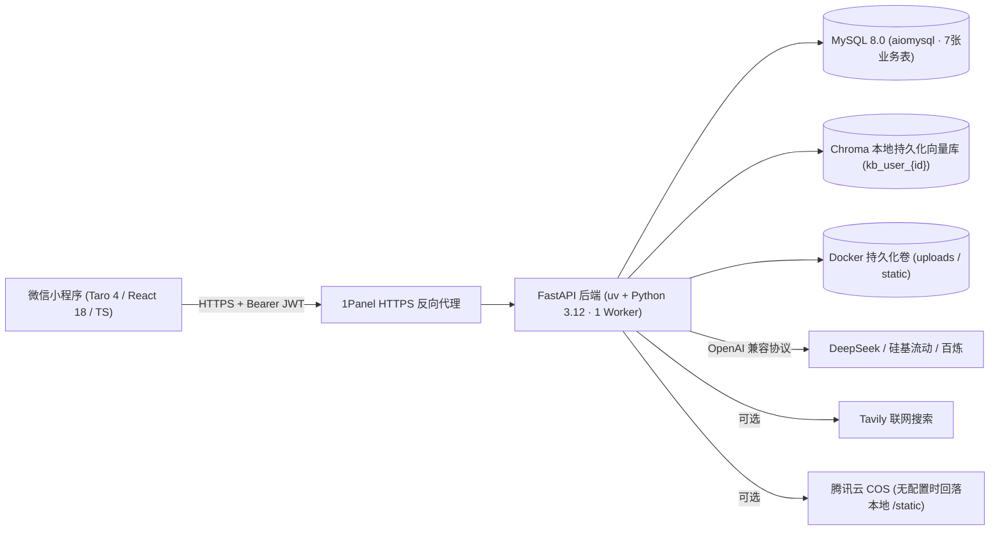

# ARCHITECTURE.md：技术与安全约束

> 状态：后端已按生产可上线标准定稿；`frontend/` 已按 Phase 2 确认原型图完成 Taro 4 H5 与微信小程序双端编译落地。详细表字段、API 契约与既有代码移植清单见 [`docs/02-design/system-architecture.md`](02-design/system-architecture.md)。

## 整体部署形态

自有云服务器通过 **Docker Compose** 运行 **FastAPI 后端（单 Worker 异步）** 与 **MySQL 8.0**，外层通过 **1Panel（Nginx / Caddy）** 提供公网 **HTTPS** 域名反向代理给微信小程序（开发版/体验版/正式版）调用。



## 锁定技术栈

- **前端**：Taro 4 (`4.1.x`) + React 18 + TypeScript + Sass，统一使用 **`pnpm`** 管理依赖（禁止混用 `npm`）；H5 编译输出至 `frontend/dist-h5/`（`hash` 路由），微信小程序编译输出至 `frontend/dist/`。
- **后端**：Python 3.12 + **`uv`（`pyproject.toml` + `uv.lock`）** + FastAPI + Pydantic v2 + Uvicorn + `structlog`。
- **AI 编排与检索**：LangChain + LangGraph（`create_react_agent`）+ `langchain-openai`（`check_embedding_ctx_length=False`）+ `langchain-chroma` + `langchain-tavily`。
- **数据存储**：MySQL 8.0（`aiomysql` 异步连接池 + 启动自动建表 DDL）+ Chroma 本地持久化 + 腾讯云 COS（含自有静态目录回落）。
- **测试**：`pytest` + `pytest-asyncio` + `httpx`（全 Mock 外部 API，保证 20+ 自动化用例稳定通过）。

## 代码组织约束（单向依赖防改乱）

```text
backend/app/
  api/v1/routes/   路由层：仅做参数接收、JWT/限流校验、调用 Service、返回 ApiResponse
  services/        业务层：流程编排、异步任务流转、限流、调用 AI 与数据访问
  llm/ + prompts/  AI 层：大模型工厂、JSON 提取容错、Prompt 模板（与业务流程解耦）
  repositories/    数据层：仅放 aiomysql SQL 读写，禁止包含业务或 AI 逻辑
  models/          数据契约：Pydantic v2 请求/响应与结构化输出 Schema
  core/            基础设施：config（含生产安全检查）、db（DDL 与断电任务回收）、auth（JWT）、rate_limit、security
```

## 数据模型与本地数据保存方式

- **MySQL 8.0** 是业务唯一事实来源，共 7 张表：`users`、`quiz_sessions`、`answer_records`、`reports`、`quiz_tasks`、`kb_documents`、`image_generation_logs`。
- **幂等列迁移与启动自愈**：`db.init_db()` 启动时基于 `INFORMATION_SCHEMA.COLUMNS` 幂等补齐新增状态列（如 `quiz_tasks.stage`、`quiz_sessions.image_status` / `image_notice`、`reports.status` / `error_message`），不破坏已有存量数据；`recover_stale_jobs()` 同步将遗留的 `pending`/`running` 出题任务、`processing` 文档以及卡在 `generating` 状态的配图/报告记录安全回收。
- **异步出题与渐进式配图**：`/quiz/generate/async` 实时推进阶段状态（`queued` -> `fetching_context` -> `generating_quiz` -> `completed`），文本题库入库后即刻完成主任务并下发答题页；若启用配图，则拆入强引用保护的后台 `asyncio.Task` 并发补图，前端通过带 JWT 归属校验的 `GET /api/v1/quiz/{quiz_id}/images` 每 2.5s 增量挂图，配图异常仅降级提示而不阻断答题。
- **秒返判分、XP 幂等与异步 AI 复盘**：`POST /api/v1/report/submit` 直接依据 `quiz_sessions.questions_json` 标准答案在服务端重算 `is_correct`、`accuracy` 与 `xp_gain`（忽略客户端自报对错，`<50ms` 秒返），在单事务内通过 `INSERT IGNORE` 保护 `answer_records` 与 `add_user_xp` 仅首次发放 XP；同时后台异步生成 AI 复盘报告，前端通过 `GET /api/v1/report/{quiz_id}` 每 2s 轮询补全（原 `POST /api/v1/report/generate` 向后兼容且共用幂等路径）。
- **知识库解析、Chroma 并发安全与非阻塞 RAG**：`.txt` / `.md` 支持 `utf-8-sig` / `utf-8` / `gb18030` 自动解码，`.md` 先按 `# / ## / ###` 标题拆分章节再做分块递归切分；扫描件/空 PDF 明确失败提示；Chroma 按 `kb_user_{user_id}` 集合隔离存储，通过 `_chroma_init_lock` 串行化客户端构建以防多线程 `SharedSystemClient` 竞态，写入按 `batch_size=32` 分批落库，文件写删与 RAG 检索工具 `search_knowledge_base` 均通过 `async def` + `asyncio.to_thread` 卸载出主事件循环。
- **上传原文档与兜底静态图片** 保存在 `KB_UPLOAD_DIR`（`./data/uploads`）与 `LOCAL_IMAGE_DIR`（`./data/static/quiz-images`）。Docker 部署时 `./data/` 必须挂载持久卷，否则重建容器会丢失知识库向量与文档。

## JWT 与安全边界（上线强约束）

- **全站 AI 接口强制鉴权**：`/api/v1/knowledge/*`、`/api/v1/quiz/*`、`/api/v1/report/*`、`/api/v1/user/profile`、`/api/v1/user/quizzes*` 均强制通过 `get_current_user` 校验 HS256 JWT（含 `user_id`、`openid`、`token_type="access"`、`iat`、`exp`），当 MySQL 连接池在线时同步核验用户记录有效；`GET /api/v1/quiz/task/{task_id}`、`GET /api/v1/quiz/{quiz_id}/images`、`POST /api/v1/report/submit` 及 `GET /api/v1/report/{quiz_id}` 均严格校验资源归属 `user_id`（越权返回 `403` / `code=4004`）。
- **生产密钥门禁**：当 `APP_ENV=production` 时，若 `JWT_SECRET` 仍为默认值或长度小于 **32 字符**，服务拒绝启动。
- **开发态登录隔离**：`POST /api/v1/user/dev-login` 仅当 `APP_ENV != "production"` 且 `ALLOW_DEV_LOGIN=true` 时开放；生产环境强制返回 `403` 禁止访问。
- **防刷限流**：对 `/quiz/generate` 与 `/quiz/generate/async` 实施单用户分钟级滑动窗口限流（默认每分钟 5 次，环境变量可调）。

## 哪些技术不能引入（硬性禁止）

- **禁止开启多 Uvicorn Worker（`--workers > 1`）**：在未把 Chroma 迁为独立 Client/Server 且把异步任务/限流迁入 Redis 前，多进程会导致 Chroma 本地文件锁冲突、限流计数与内存任务分裂；必须保持单 Worker 异步事件循环运行（`--workers 1`）。
- **禁止将 `aiomysql` 重写为 SQLAlchemy ORM**：既有 5 个 Repository 与 SQL 已经过充分验证，保持原结构防止 AI 重写引发隐性缺陷。
- **禁止在未确认 [`docs/02-design/prototypes/`](02-design/prototypes/README.md) 原型图前直接编码修改 `frontend/` 页面样式**。
- **禁止在第一版引入 Celery / Kafka / Redis 分布式集群 / 多人 WebSocket 同步 / 微信云托管 SDK**。
